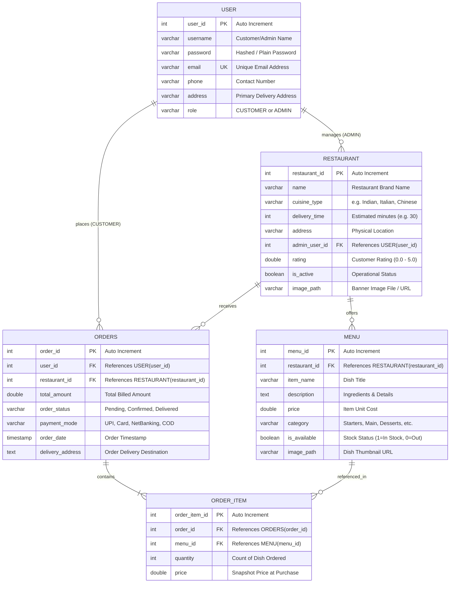

# FastX —  Food Delivery & Restaurant Management Platform

> A full-stack, enterprise-grade Java EE web application engineered with modern Model-View-Controller (MVC) architecture, JDBC DAO design patterns, and an interactive luxury user interface. FastX delivers an end-to-end food ordering ecosystem for customers and a centralized administration console for restaurant partners.

[](https://www.oracle.com/java/)
[](https://jakarta.ee/)
[](https://tomcat.apache.org/)
[](https://www.mysql.com/)
[](#)

---

## 📑 Table of Contents
1. [Project Overview](#-project-overview)
2. [Complete Feature Matrix](#-complete-feature-matrix)
   - [Customer Module](#1-customer-module)
   - [Cart & Checkout System](#2-cart--checkout-system)
   - [Order Tracking & History](#3-order-tracking--history)
   - [Security & OTP Recovery via SMTP](#4-security--otp-recovery-via-smtp)
   - [Admin Management Suite](#5-admin-management-suite)
3. [Architecture & Design Pattern](#-architecture--design-pattern)
4. [Database Architecture & Relationships](#-database-architecture--relationships)
   - [Entity Relationship Diagram (ERD)](#entity-relationship-diagram-erd)
   - [Data Dictionary & Constraints](#data-dictionary--constraints)
   - [Complete SQL DDL Script](#complete-sql-ddl-script)
5. [Complete Project Directory Structure](#-complete-project-directory-structure)
6. [Technology Stack](#-technology-stack)
7. [Installation & Setup Guide](#-installation--setup-guide)
8. [Configuration & Credential Security](#-configuration--credential-security)

---

## 🌟 Project Overview

**FastX** provides a seamless, dynamic gourmet dining and delivery experience. The platform decouples business logic, data persistence, and presentation layers using:
- **Presentation Layer**: Custom-styled JSPs using modern Vanilla CSS3 (responsive flex/grid, micro-animations, glassmorphism, eye-toggle passwords) and ES6 JavaScript.
- **Controller Layer (Servlets)**: 17 dedicated Jakarta Servlets handling request routing, session lifecycle, authentication, role authorization, and state transitions.
- **Service & Utility Layer**: Dynamic configuration loaders, database connection pooling, and Google SMTP Jakarta Mail integration.
- **DAO Layer (Data Access Objects)**: Clean JDBC interfaces and implementations executing parameterized queries with protection against SQL injection.
- **Database Layer**: Relational MySQL database enforcing foreign key cascades and referential integrity across users, restaurants, menus, orders, and order items.

---

## 🚀 Complete Feature Matrix

### 1. Customer Module
- **Interactive Landing Page (`index.jsp`)**:
  - Hero banner with animated call-to-actions.
  - Featured dishes, restaurant recommendations, and value proposition cards.
  - Quick-search entry points into restaurants and menus.
- **Restaurant Catalog (`restaurant.jsp`)**:
  - Dynamic listing of all verified, active restaurants.
  - Filter by cuisine type (Indian, Chinese, Italian, Continental, Biryani, Fast Food).
  - Search by restaurant name and location.
  - Live metadata: delivery duration estimate (e.g., 25-30 mins), customer rating score (e.g., 4.5/5.0), and delivery distance.
- **Menu Exploration (`menu.jsp`)**:
  - Restaurant banner displaying cuisine type, address, and ratings.
  - Categorized menu layout (Starters, Main Course, Breads, Desserts, Beverages).
  - Veg / Non-Veg indicator badges.
  - Detailed dish descriptions, pricing, and availability tags.
  - One-click "Add to Cart" action with instant visual feedback.

### 2. Cart & Checkout System
- **Intelligent Shopping Cart (`Cart.java`, `CartController.java`, `cart.jsp`)**:
  - **In-Memory Session Persistence**: Cart state persists throughout the user session without unnecessary database writes.
  - **Restaurant Isolation Policy**: If a user attempts to add an item from a different restaurant, FastX prompts the user or resets the cart to ensure single-restaurant order consistency.
  - **Dynamic Steppers**: Real-time item increment (`+`), decrement (`-`), and complete item deletion.
  - **Automated Summary Engine**: Instant calculation of item total, GST/taxes, delivery packaging fee, and grand total payable.
  - **Auto-Reset**: Automatic cart cleanup and restaurant unbinding when the last item is removed.
- **Secure Checkout (`CheckoutController.java`, `checkout.jsp`)**:
  - Pre-filled customer profile details (Name, Phone, Delivery Address) with real-time override options.
  - Multiple payment mode selections:
    - 💳 Credit / Debit Cards
    - 📱 UPI / QR (PhonePe, Google Pay, Paytm)
    - 🌐 Net Banking
    - 💵 Cash on Delivery (COD)
  - Detailed order recap with transparent bill breakdown.

### 3. Order Tracking & History
- **Order Placement Engine (`OrderController.java`)**:
  - Transactional order creation: generates a unique `order_id` in the `orders` table.
  - Batch insertion of individual items into `order_item` referencing `menu_id`, unit price, and quantities.
  - Atomic session cart clearance upon order confirmation.
- **Instant Order Confirmation (`orderConfirmation.jsp`)**:
  - Live animated success checkmark.
  - Generated Order ID, delivery timeline, delivery address, and total amount paid.
- **Order History Dashboard (`OrderHistoryController.java`, `orderHistory.jsp`)**:
  - Chronological timeline of all past orders placed by the authenticated user.
  - Order status badges: `Pending`, `Confirmed`, `In Preparation`, `Out for Delivery`, `Delivered`.
  - Itemized breakdowns for every order with unit prices, quantity counts, and subtotal metrics.

### 4. Security & OTP Recovery via SMTP
- **User Authentication (`LoginController.java`, `RegisterController.java`)**:
  - Session-based user authentication with role validation (`CUSTOMER` vs `ADMIN`).
  - Interactive password visibility toggles (eye icons) across all password inputs.
- **Customer Profile Management (`UpdateProfileController.java`, `ChangePasswordController.java`, `profile.jsp`)**:
  - View and update username, phone number, and default delivery address.
  - Collapsible in-page password update with current password verification.
- **Two-Factor OTP Password Reset (`ForgotPasswordController.java`, `EmailService.java`, `forgotPassword.jsp`)**:
  - **Step 1 (OTP Dispatch)**: Customer enters registered email; system validates email existence and triggers `EmailService`.
  - **Cryptographic OTP Generation**: 6-digit random code (`100000 - 999999`) generated with 10-minute validity.
  - **Luxury Branded HTML Email**: Delivered directly to the user's Gmail inbox using Google SMTP (`smtp.gmail.com:587` with TLS 1.2).
  - **Presentation Backup**: OTP is simultaneously printed to the Eclipse / Server console for live project evaluations without internet latency.
  - **Step 2 (Verification & Password Overwrite)**: Validates submitted OTP against session-stored OTP; upon match, updates password in database via `UserDao.updatePassword()`.

### 5. Admin Management Suite
- **Admin Authentication (`AdminLoginController.java`, `AdminRegisterController.java`, `adminLogin.jsp`)**:
  - Distinct administrative login portal with role-gate verification ensuring only `ADMIN` accounts can access.
  - Dedicated admin password recovery (`adminForgotPassword.jsp`).
- **Comprehensive Admin Dashboard (`AdminDashboardController.java`, `adminDashboard.jsp`)**:
  - **Analytics KPI Metrics**:
    - Total Orders Count
    - Total Gross Revenue (₹)
    - Total Active Restaurants
    - Total Registered Users
  - **Restaurant Management (`RestaurantAdminController.java`)**:
    - Add new restaurants with name, cuisine type, delivery time, address, and banner image.
    - Edit restaurant details and toggle active/inactive operational status.
    - Delete restaurants (with cascading menu cleanup).
  - **Menu Management (`MenuAdminController.java`)**:
    - Add dishes mapped to specific restaurants with category, price, and descriptions.
    - Toggle instant dish availability (`In Stock` / `Out of Stock`).
    - Delete obsolete menu items.
  - **Live Order Management**:
    - Real-time table of incoming orders across all managed restaurants.
    - Ability to review customer address, payment mode, and order status.

---

## 🏗️ Architecture & Design Pattern

FastX follows the classical **Three-Tier MVC Architecture** combined with the **Data Access Object (DAO)** pattern:

```
┌────────────────────────────────────────────────────────┐
│                   PRESENTATION TIER                    │
│      JSP Pages (JSTL, EL) + CSS3 + Vanilla ES6 JS      │
└───────────────────────────▲────────────────────────────┘
                            │ (HTTP Requests / Responses)
┌───────────────────────────▼────────────────────────────┐
│                    CONTROLLER TIER                     │
│               17 Jakarta HTTP Servlets                 │
│  (Session Management, Authentication, Flow Control)   │
└───────────────────────────▲────────────────────────────┘
                            │ (Java Objects / Models)
┌───────────────────────────▼────────────────────────────┐
│                     BUSINESS TIER                      │
│      Models (Cart, User, Restaurant, Menu, Order)      │
│     Services & Utilities (DBConnection, EmailService)  │
└───────────────────────────▲────────────────────────────┘
                            │ (CRUD / Parameterized SQL)
┌───────────────────────────▼────────────────────────────┐
│                    PERSISTENCE TIER                    │
│         DAO Interfaces & JDBC Implementations          │
│  (UserDao, RestaurantDao, MenuDao, OrderDao, ItemDao)  │
└───────────────────────────▲────────────────────────────┘
                            │ (JDBC Connection)
┌───────────────────────────▼────────────────────────────┐
│                     DATABASE TIER                      │
│                  MySQL Relational DB                   │
└────────────────────────────────────────────────────────┘
```

---

## 🗄️ Database Architecture & Relationships

### Entity Relationship Diagram (ERD)



---

### Data Dictionary & Constraints

| Table | Column | Type | Constraints | Description |
|---|---|---|---|---|
| **`user`** | `user_id` | `INT` | `PRIMARY KEY`, `AUTO_INCREMENT` | Unique identifier for each user |
| | `username` | `VARCHAR(100)` | `NOT NULL` | User full name |
| | `password` | `VARCHAR(255)` | `NOT NULL` | Account login password |
| | `email` | `VARCHAR(150)` | `NOT NULL`, `UNIQUE` | User email for auth & OTP delivery |
| | `phone` | `VARCHAR(20)` | `NOT NULL` | Contact number for delivery |
| | `address` | `TEXT` | `NOT NULL` | Default delivery address |
| | `role` | `VARCHAR(20)` | `DEFAULT 'CUSTOMER'` | Role permission (`CUSTOMER`, `ADMIN`) |
| **`restaurant`** | `restaurant_id` | `INT` | `PRIMARY KEY`, `AUTO_INCREMENT` | Unique restaurant identifier |
| | `name` | `VARCHAR(150)` | `NOT NULL` | Restaurant brand name |
| | `cuisine_type` | `VARCHAR(100)` | `NOT NULL` | Cuisine classification |
| | `delivery_time` | `INT` | `NOT NULL` | Average delivery time in minutes |
| | `address` | `TEXT` | `NOT NULL` | Restaurant kitchen address |
| | `admin_user_id` | `INT` | `FOREIGN KEY (user.user_id)` | Admin owner reference |
| | `rating` | `DECIMAL(2,1)` | `DEFAULT 4.0` | Rating score between 1.0 - 5.0 |
| | `is_active` | `TINYINT(1)` | `DEFAULT 1` | `1` for active, `0` for inactive |
| | `image_path` | `VARCHAR(255)` | `NULL` | Image banner URL or filename |
| **`menu`** | `menu_id` | `INT` | `PRIMARY KEY`, `AUTO_INCREMENT` | Unique dish identifier |
| | `restaurant_id` | `INT` | `FOREIGN KEY (restaurant.restaurant_id)` | Owning restaurant |
| | `item_name` | `VARCHAR(150)` | `NOT NULL` | Dish title |
| | `description` | `TEXT` | `NULL` | Dish details & ingredients |
| | `price` | `DECIMAL(10,2)` | `NOT NULL` | Unit selling price |
| | `category` | `VARCHAR(50)` | `NOT NULL` | Starters, Main, Desserts, Beverages |
| | `is_available` | `TINYINT(1)` | `DEFAULT 1` | Stock toggle (`1` = available) |
| | `image_path` | `VARCHAR(255)` | `NULL` | Dish photograph URL or path |
| **`orders`** | `order_id` | `INT` | `PRIMARY KEY`, `AUTO_INCREMENT` | Unique order reference number |
| | `user_id` | `INT` | `FOREIGN KEY (user.user_id)` | Placing customer ID |
| | `restaurant_id` | `INT` | `FOREIGN KEY (restaurant.restaurant_id)` | Target restaurant ID |
| | `total_amount` | `DECIMAL(10,2)` | `NOT NULL` | Grand total payable |
| | `order_status` | `VARCHAR(50)` | `DEFAULT 'Pending'` | Pending, Confirmed, Delivered, etc. |
| | `payment_mode` | `VARCHAR(50)` | `NOT NULL` | UPI, Card, NetBanking, COD |
| | `order_date` | `TIMESTAMP` | `DEFAULT CURRENT_TIMESTAMP` | Time order was placed |
| | `delivery_address` | `TEXT` | `NOT NULL` | Confirmed drop address |
| **`order_item`** | `order_item_id` | `INT` | `PRIMARY KEY`, `AUTO_INCREMENT` | Unique line item identifier |
| | `order_id` | `INT` | `FOREIGN KEY (orders.order_id)` | Parent order reference (`ON DELETE CASCADE`) |
| | `menu_id` | `INT` | `FOREIGN KEY (menu.menu_id)` | Ordered dish reference |
| | `quantity` | `INT` | `NOT NULL` | Number of servings |
| | `price` | `DECIMAL(10,2)` | `NOT NULL` | Historical item price snapshot |

---

### Complete SQL DDL Script

```sql
-- 1. Create Database
CREATE DATABASE IF NOT EXISTS FastX;
USE FastX;

-- 2. User Table (Customers & Admins)
CREATE TABLE IF NOT EXISTS user (
    user_id INT AUTO_INCREMENT PRIMARY KEY,
    username VARCHAR(100) NOT NULL,
    password VARCHAR(255) NOT NULL,
    email VARCHAR(150) NOT NULL UNIQUE,
    phone VARCHAR(20) NOT NULL,
    address TEXT NOT NULL,
    role VARCHAR(20) NOT NULL DEFAULT 'CUSTOMER'
);

-- 3. Restaurant Table
CREATE TABLE IF NOT EXISTS restaurant (
    restaurant_id INT AUTO_INCREMENT PRIMARY KEY,
    name VARCHAR(150) NOT NULL,
    cuisine_type VARCHAR(100) NOT NULL,
    delivery_time INT NOT NULL DEFAULT 30,
    address TEXT NOT NULL,
    admin_user_id INT,
    rating DECIMAL(2,1) DEFAULT 4.5,
    is_active TINYINT(1) DEFAULT 1,
    image_path VARCHAR(255),
    FOREIGN KEY (admin_user_id) REFERENCES user(user_id) ON DELETE SET NULL
);

-- 4. Menu Table
CREATE TABLE IF NOT EXISTS menu (
    menu_id INT AUTO_INCREMENT PRIMARY KEY,
    restaurant_id INT NOT NULL,
    item_name VARCHAR(150) NOT NULL,
    description TEXT,
    price DECIMAL(10,2) NOT NULL,
    category VARCHAR(50) NOT NULL,
    is_available TINYINT(1) DEFAULT 1,
    image_path VARCHAR(255),
    FOREIGN KEY (restaurant_id) REFERENCES restaurant(restaurant_id) ON DELETE CASCADE
);

-- 5. Orders Table
CREATE TABLE IF NOT EXISTS orders (
    order_id INT AUTO_INCREMENT PRIMARY KEY,
    user_id INT NOT NULL,
    restaurant_id INT NOT NULL,
    total_amount DECIMAL(10,2) NOT NULL,
    order_status VARCHAR(50) NOT NULL DEFAULT 'Pending',
    payment_mode VARCHAR(50) NOT NULL,
    order_date TIMESTAMP DEFAULT CURRENT_TIMESTAMP,
    delivery_address TEXT NOT NULL,
    FOREIGN KEY (user_id) REFERENCES user(user_id) ON DELETE CASCADE,
    FOREIGN KEY (restaurant_id) REFERENCES restaurant(restaurant_id) ON DELETE CASCADE
);

-- 6. Order Items Table (Junction Table)
CREATE TABLE IF NOT EXISTS order_item (
    order_item_id INT AUTO_INCREMENT PRIMARY KEY,
    order_id INT NOT NULL,
    menu_id INT NOT NULL,
    quantity INT NOT NULL DEFAULT 1,
    price DECIMAL(10,2) NOT NULL,
    FOREIGN KEY (order_id) REFERENCES orders(order_id) ON DELETE CASCADE,
    FOREIGN KEY (menu_id) REFERENCES menu(menu_id) ON DELETE CASCADE
);
```

---

## 📂 Complete Project Directory Structure

```text
FastX/
│
├── .classpath                               # Eclipse IDE build path configuration
├── .gitignore                               # Excludes build/, class files, and local config.properties
├── .project                                 # Eclipse project definition
│
├── .settings/                               # Eclipse project facets & compiler settings
│   ├── .jsdtscope
│   ├── org.eclipse.core.resources.prefs
│   ├── org.eclipse.jdt.core.prefs
│   ├── org.eclipse.wst.common.component
│   ├── org.eclipse.wst.common.project.facet.core.xml
│   ├── org.eclipse.wst.jsdt.ui.superType.container
│   └── org.eclipse.wst.jsdt.ui.superType.name
│
├── README.md                                # Comprehensive project documentation
├── config.properties.example                # Root environment template for cloning developers
│
└── src/
    └── main/
        ├── java/
        │   ├── config.properties            # (Git-Ignored) Local credentials for MySQL & Gmail SMTP
        │   ├── config.properties.example    # Configuration template inside classpath
        │   │
        │   └── com/tap/
        │       │
        │       ├── controler/               # 17 Jakarta HTTP Servlets
        │       │   ├── AdminDashboardController.java    # Dashboard metrics, orders, & catalog aggregation
        │       │   ├── AdminLoginController.java        # Administrator authentication & session gate
        │       │   ├── AdminRegisterController.java     # Administrator onboarding with ADMIN role
        │       │   ├── CartController.java              # Add, increment, decrement, remove, reset cart
        │       │   ├── ChangePasswordController.java    # In-profile authenticated password update
        │       │   ├── CheckoutController.java          # Checkout dispatch & bill verification
        │       │   ├── ForgotPasswordController.java    # Two-step OTP generation & validation engine
        │       │   ├── LoginController.java             # Customer authentication & session management
        │       │   ├── LogoutController.java            # Session invalidation & safe sign-out
        │       │   ├── MenuAdminController.java         # Admin CRUD operations for restaurant menus
        │       │   ├── MenuController.java              # Customer menu exploration by restaurant ID
        │       │   ├── OrderController.java             # Transactional order placement & cart flush
        │       │   ├── OrderHistoryController.java      # Customer order tracking & historical records
        │       │   ├── RegisterController.java          # Customer registration & input validation
        │       │   ├── RestaurantAdminController.java   # Admin CRUD operations for restaurants
        │       │   ├── RestaurantController.java        # Restaurant listing & cuisine filter dispatch
        │       │   └── UpdateProfileController.java     # Customer profile contact & address updater
        │       │
        │       ├── dao/                     # Data Access Object Interfaces
        │       │   ├── MenuDao.java                     # Contract for Menu CRUD & filters
        │       │   ├── OrderDao.java                    # Contract for Orders & status updates
        │       │   ├── OrderItemDao.java                # Contract for Order Item insertions & lookups
        │       │   ├── RestaurantDao.java               # Contract for Restaurant management
        │       │   └── UserDao.java                     # Contract for Users & OTP password updates
        │       │
        │       ├── daoimpl/                 # JDBC Implementations with Parameterized Queries
        │       │   ├── MenuDaoImpl.java                 # PreparedStatement implementations for Menu
        │       │   ├── OrderDaoImpl.java                # PreparedStatement implementations for Orders
        │       │   ├── OrderItemDaoImpl.java            # PreparedStatement implementations for Order Items
        │       │   ├── RestaurantDaoImpl.java           # PreparedStatement implementations for Restaurant
        │       │   └── UserDaoImpl.java                 # PreparedStatement implementations for User
        │       │
        │       ├── model/                   # Domain Entities & Business Logic
        │       │   ├── Cart.java                        # Session cart state machine & restaurant isolation
        │       │   ├── CartItem.java                    # Single dish cart entry with quantity & price
        │       │   ├── Menu.java                        # Dish entity model
        │       │   ├── Order.java                       # Master order entity model
        │       │   ├── OrderItem.java                   # Line item junction model
        │       │   ├── Restaurant.java                  # Restaurant brand entity model
        │       │   └── User.java                        # User entity model (Customer/Admin)
        │       │
        │       └── util/                    # Infrastructure, Mail, & Connectivity
        │           ├── DBConnection.java                # Dynamic config/env MySQL connection factory
        │           ├── DBConnectionTest.java            # Standalone test runner for database validation
        │           ├── EmailService.java                # Google SMTP Jakarta Mail OTP delivery service
        │           ├── RestaurantDaoTest.java           # Unit test suite for Restaurant operations
        │           └── UserDaoTest.java                 # Unit test suite for User DAO operations
        │
        └── webapp/                          # Presentation Tier (JSPs, CSS, Web Deployment)
            ├── META-INF/
            │   └── MANIFEST.MF
            │
            ├── WEB-INF/
            │   ├── web.xml                              # Deployment descriptor & welcome file mappings
            │   └── lib/                                 # Runtime dependency JARs
            │       ├── jakarta.activation-2.0.1.jar     # MIME type & attachment data handling
            │       ├── jakarta.mail-2.0.1.jar           # SMTP messaging & TLS authentication
            │       └── mysql-connector-j-9.2.0.jar      # Official MySQL Type-4 JDBC driver
            │
            ├── css/                                     # 14 Custom Handcrafted Modern Stylesheets
            │   ├── adminDashboard.css                   # High-density admin grid & KPI cards
            │   ├── adminLogin.css                       # Specialized administrative login styling
            │   ├── cart.css                             # Dynamic cart stepper & bill calculation layout
            │   ├── checkout.css                         # Multi-step checkout & payment accordion
            │   ├── forgotPassword.css                   # OTP verification card & countdown styling
            │   ├── index.css                            # Modern hero banner, features & typography
            │   ├── login.css                            # Floating auth inputs & eye toggles
            │   ├── menu.css                             # Menu card grid, veg/non-veg tags, & add buttons
            │   ├── navbar.css                           # Glassmorphic header, search & cart badge
            │   ├── orderConfirmation.css                # Success checkmark animation & receipt card
            │   ├── orderHistory.css                     # Timeline status badges & item tables
            │   ├── profile.css                          # Profile avatar, detail cards & collapsible forms
            │   ├── register.css                         # Customer onboarding form & validators
            │   └── restaurant.css                       # Restaurant cards, cuisine chips, & rating badges
            │
            ├── adminDashboard.jsp                       # Centralized administrator portal
            ├── adminForgotPassword.jsp                  # Administrator OTP recovery
            ├── adminLogin.jsp                           # Administrator authentication portal
            ├── cart.jsp                                 # Interactive shopping cart view
            ├── checkout.jsp                             # Payment & delivery checkout view
            ├── forgotPassword.jsp                       # Customer two-step OTP recovery view
            ├── index.jsp                                # Public home & landing page
            ├── login.jsp                                # Customer login view
            ├── menu.jsp                                 # Restaurant menu & dish catalog view
            ├── navbar.jsp                               # Reusable navigation header component
            ├── orderConfirmation.jsp                    # Order success & receipt view
            ├── orderHistory.jsp                         # Historical orders list view
            ├── profile.jsp                              # Customer profile & account view
            ├── register.jsp                             # Customer registration view
            └── restaurant.jsp                           # Restaurant listing & search view
```

---

## 💻 Technology Stack

| Domain | Technology / Library | Version | Purpose |
|---|---|---|---|
| **Core Platform** | Java Development Kit (JDK) | 21 LTS | Core enterprise backend runtime |
| **Servlet Standard** | Jakarta EE (Servlets & JSP) | 10 (Web 5.0/6.0) | Controller routing, filters, and dynamic JSP rendering |
| **Application Server**| Apache Tomcat | 10.1+ | Servlet engine, HTTP request dispatching, session manager |
| **Database Driver** | MySQL Connector/J | 9.2.0 | JDBC Type-4 driver for MySQL connectivity |
| **Email Protocol** | Jakarta Mail + Activation | 2.0.1 | Google SMTP TLS email delivery for password reset OTPs |
| **Database Engine** | MySQL Server | 8.0+ | Relational persistence & foreign key integrity |
| **Design / Frontend**| HTML5, CSS3, ES6 JavaScript | Native | Custom responsive UI, flexbox, CSS grid, micro-animations |
| **Web Typography** | Google Fonts | Inter, Plus Jakarta Sans | Modern typography design system |

---

## 🛠️ Installation & Setup Guide

### 1. Prerequisites
- **JDK 21** or later installed and configured on your system path.
- **Apache Tomcat 10.1+** installed.
- **MySQL Server 8.0+** running locally (or remotely).
- **Eclipse IDE for Enterprise Java and Web Developers** (or IntelliJ IDEA Ultimate).

---

### 2. Clone the Repository
```bash
git clone https://github.com/naroju-rajesh/FastX-App.git
cd FastX-App
```

---

### 3. Initialize the Database
1. Open your MySQL client (MySQL Workbench, HeidiSQL, or CLI):
   ```bash
   mysql -u root -p
   ```
2. Execute the DDL script provided in the [Complete SQL DDL Script](#complete-sql-ddl-script) section above to create the `FastX` database and all 5 tables (`user`, `restaurant`, `menu`, `orders`, `order_item`).

---

### 4. Configure Credentials
1. Copy `config.properties.example` to `src/main/java/config.properties`:
   ```bash
   # On Windows PowerShell:
   Copy-Item .\config.properties.example .\src\main\java\config.properties
   ```
2. Open `src/main/java/config.properties` and provide your MySQL credentials and Gmail SMTP App Password:
   ```properties
   # Database Configuration
   db.url=jdbc:mysql://localhost:3306/FastX
   db.user=root
   db.password=YOUR_MYSQL_PASSWORD

   # Email Service (Google SMTP App Password)
   # Generate your 16-letter App Password at: https://myaccount.google.com/apppasswords
   mail.sender.email=your_email@gmail.com
   mail.sender.password=your_16_digit_app_password
   ```

---

### 5. Import and Run in Eclipse IDE
1. Launch **Eclipse IDE**.
2. Go to **File** > **Import...** > **General** > **Existing Projects into Workspace**.
3. Set the root directory to your cloned `FastX` repository folder and click **Finish**.
4. In the **Servers** tab, click **New** > **Server** > **Apache Tomcat v10.1** and point it to your Tomcat 10.1 installation directory.
5. Right-click the `FastX` project > **Run As** > **Run on Server**.
6. Open your browser and navigate to:
   ```
   http://localhost:8080/FastX/
   ```

---

## 🔐 Configuration & Credential Security

- **No Hardcoded Secrets**: All passwords, API credentials, and SMTP secrets have been completely decoupled from the Java codebase.
- **Dynamic Property Loader**: [`DBConnection.java`](file:///c:/JAVA_WORKSPACE/FastX/src/main/java/com/tap/util/DBConnection.java) and [`EmailService.java`](file:///c:/JAVA_WORKSPACE/FastX/src/main/java/com/tap/util/EmailService.java) automatically inspect:
  1. `config.properties` from the runtime classpath.
  2. System Environment Variables (`DB_URL`, `DB_USER`, `DB_PASSWORD`, `MAIL_SENDER_EMAIL`, `MAIL_SENDER_PASSWORD`).
- **`.gitignore` Enforced**: The local `config.properties` file is git-ignored, preventing personal passwords or tokens from ever leaking into public version control.

---

## 👥 Authors & Acknowledgments

- **Lead Developer**: Rajesh Naroju ([@naroju-rajesh](https://github.com/naroju-rajesh))
- **Repository**: [https://github.com/naroju-rajesh/FastX-App.git](https://github.com/naroju-rajesh/FastX-App.git)
- Built for educational demonstration and enterprise portfolio evaluation.
